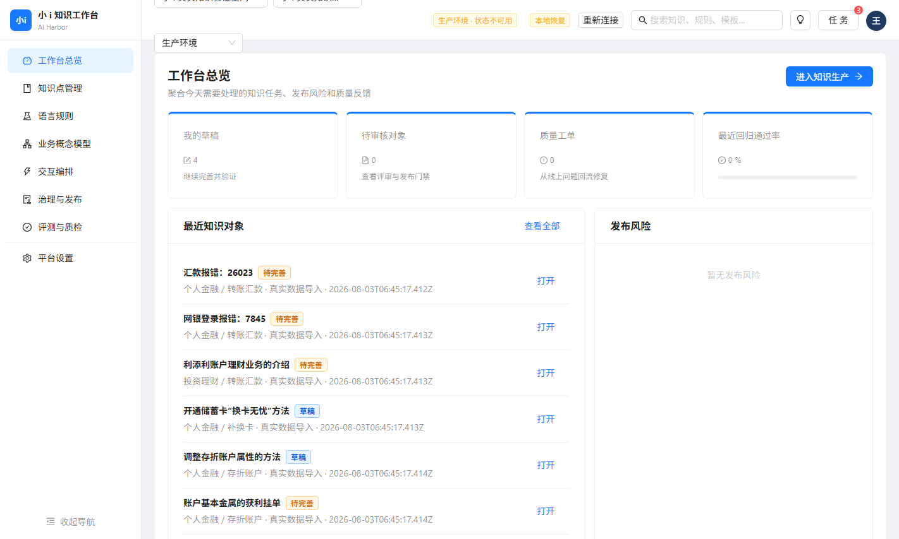
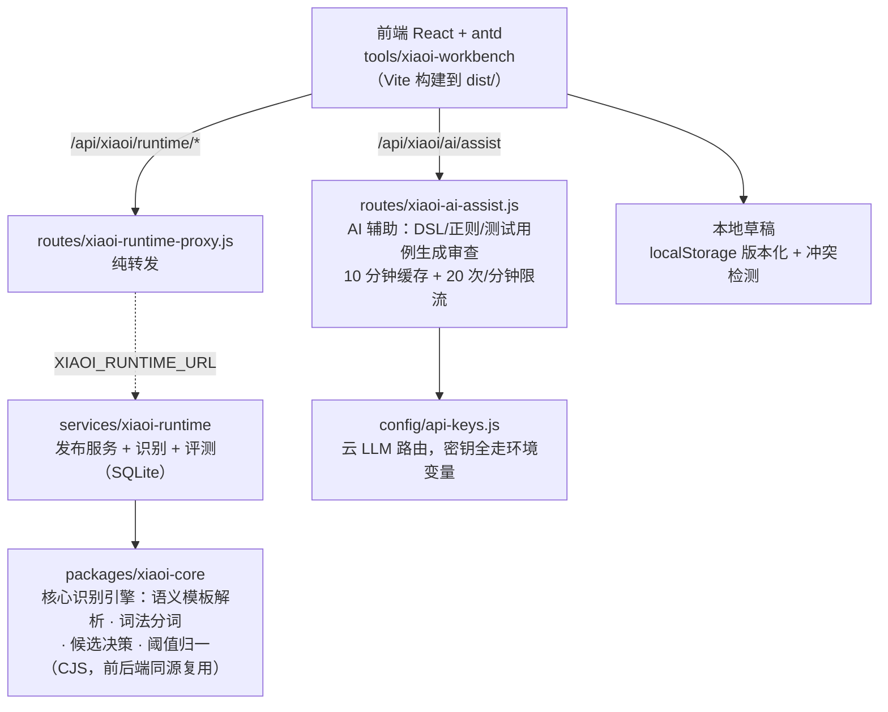

<p align="center">

</p>

# Intent-Knowledge-Builder

小 i 知识工作台：知识点、语言规则、业务概念模型、交互编排、治理发布与反馈质检的一体化工作台。规则式（非训练式）知识系统的作者工具链——每条知识的匹配行为可解释、可测试、可发布。

## 是什么

面向**规则驱动的意图识别系统**（小 i 兼容体系）的知识构建工作台。与训练模型不同：这里的"知识"是显式的 DSL 规则（语义模板、词法类、概念语义块、动作编排），识别引擎按规则匹配，每个意图命中都能给出完整的决策路径——适合银行等对可解释性与可审计性要求高的场景。

八个工作域（左侧导航）：

| 工作域 | 职责 |
|---|---|
| 工作台总览 | 知识资产统计、运行状态、草稿同步 |
| 知识点管理 | 知识点 CRUD + 规则集编辑 + 追问话术 |
| 语言规则 | 小 i 兼容 DSL（`[信用卡][激活]` 语义模板，前缀 `&`/`&&`/`&+` 控制匹配模式）+ 正则规则 + 词法类 |
| 业务概念模型 | 概念语义块（渠道/动作/参数映射） |
| 交互编排 | 动作调用编排、参数校验、多渠道预览 |
| 治理与发布 | 发布门禁（release gates）、版本管理、环境晋升 |
| 评测与质检 | 识别评测（CSV 用例集）、准确率统计、逐样本分类 |
| 平台设置 | 运行时连接、阈值、环境配置 |

## 快速开始

```bash
git clone https://github.com/wanshoulu/Intent-Knowledge-Builder.git
cd Intent-Knowledge-Builder
npm start            # → http://127.0.0.1:3200（零依赖，前端已预构建）
```

**可选组件：**

```bash
# AI 辅助（DSL 生成/审查、正则生成、测试用例生成）——配 DEEPSEEK_KEY 后生效
cp .env.example .env    # 填入密钥

# 小 i 运行时（意图识别试算，需 packages/xiaoi-core）
npm run runtime         # → http://127.0.0.1:3100（主服务默认已指向该地址，无需额外设置）
```

## 从源码重建前端

`tools/xiaoi-workbench/dist/` 已含预构建产物，开箱即用。修改源码后：

```bash
cd tools/xiaoi-workbench
npm install
npm run build           # Vite + React + antd，产物输出到 dist/
npm test                # 13 套 38 项测试（vitest + @testing-library）
```

## 架构



`packages/xiaoi-core` 是识别引擎的单点实现：前端（规则编辑器的实时校验/试算）与后端运行时（发布后的识别）引用同一份代码，保证"编辑时所见 = 运行时所得"。

## 名词表

| 名词 | 含义 |
|---|---|
| 小 i | 规则式智能问答/意图识别体系的兼容语法族（DSL 模板 + 词法类 + 动作编排），常见于银行客服场景 |
| DSL 语义模板 | 意图匹配规则，如 `[信用卡][激活]`；前缀控制匹配强度：`&`（加权）/ `&&`（精确）/ `&+`（兜底） |
| 词法类（lexicon） | 同义词集合（如"手机号/预留号码/联系号码"），模板槽位引用词法类而非字面词 |
| 概念语义块 | 业务概念的参数化定义：渠道 → 动作 → 参数映射（如"打开信用卡账单"在手机银行渠道的动作调用） |
| 知识点 | 一条完整的意图知识：语义模板 + 追问话术 + 扩展问法 + 规则集 |
| 扩展问法（expanded questions） | 知识点的同义问句变体，识别时归并到同一意图 |
| 发布门禁（release gates） | 版本晋升前的强制检查（规则校验、测试通过率、评测达标） |
| 识别评测 | 用例集（CSV：问句 + 期望意图）批量跑识别引擎，输出准确率与逐样本分类 |
| Agent Run（运行时） | 小 i 运行时（services/xiaoi-runtime）承载发布后的知识包，提供 recognize / 评测 / 发布 API |

## 测试

```bash
npm run test:front     # 前端 13 套 38 项（vitest：DSL 解析/规则引擎/评测/组件交互）
npm run test:runtime   # 运行时 7 套（node:test：识别器/发布/评测/HTTP）
```

## 目录

```
server.js                      入口（302 → 工作台，静态 dist/ 白名单）
routes/xiaoi-ai-assist.js      AI 辅助（云 LLM，缓存 + 限流）
routes/xiaoi-runtime-proxy.js  运行时代理（转发 XIAOI_RUNTIME_URL）
packages/xiaoi-core/           核心识别引擎（CJS，前后端同源复用）
services/xiaoi-runtime/        小 i 运行时（发布/识别/评测，SQLite，Docker 就绪）
tools/xiaoi-workbench/         前端（src/ 源码 + dist/ 预构建 + tests/）
```

## 安全说明

- 密钥一律环境变量（`.env.example` 模板；`.env` 不入库）
- 静态服务只放行 `dist/`：源码、测试、node_modules、运行时数据一律 403
- AI 辅助内置限流（20 次/分钟）与输入长度上限（8000 字符）

## 已知限制

- `packages/xiaoi-core` 为 git 历史恢复版（2026-07 快照），前端源码与其存在少量代际差异：**dist 预构建产物为最新版功能完整可用**；从源码重建时，38 项测试中与历史组件相关的交互细节以恢复版为准
- 意图识别试算依赖小 i 运行时；未启动时试算入口返回"运行时不可用"（工作台其余功能不受影响，草稿保存在本地）
- 知识数据当前存于浏览器 localStorage（版本化 + 冲突检测）；多用户协同与服务端持久化需运行时配合
- 免登录设计，默认只听 127.0.0.1；公网部署需自行加反向代理鉴权

## License

MIT
